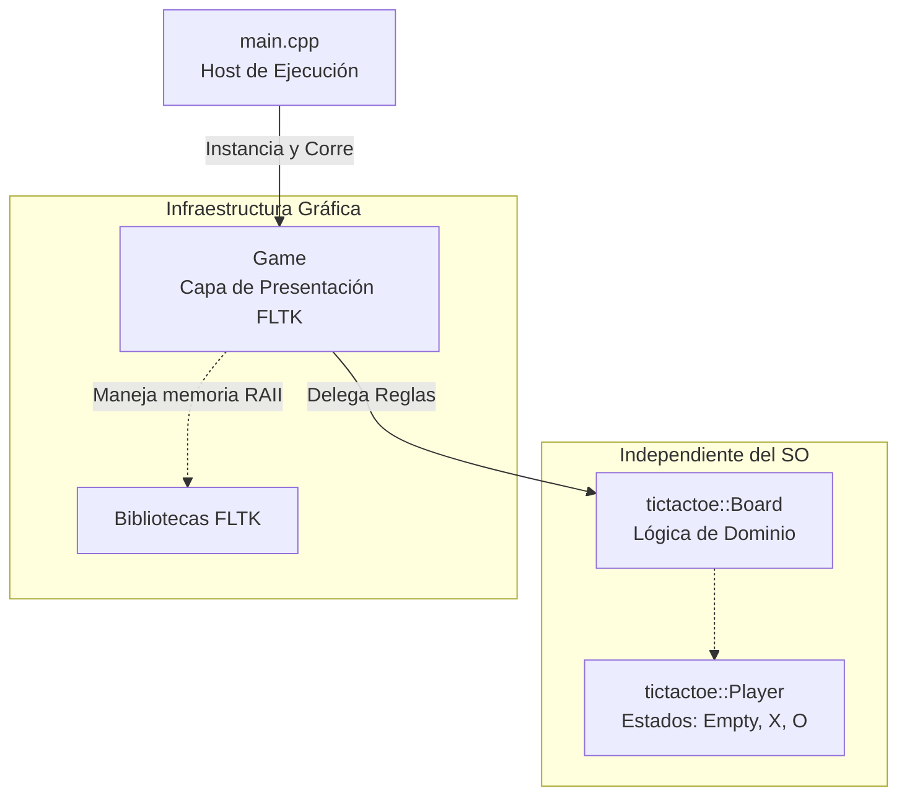

#  Ta Te Ti (Tic-Tac-Toe)

Un videojuego clásico implementado con la filosofía **GREENSOFT**: máxima eficiencia computacional, separación de responsabilidades y un uso responsable de los recursos de hardware. 

Desarrollado en **C++17**, la interfaz gráfica está impulsada por el toolkit **FLTK** (Fast Light Toolkit), operando bajo estándares estrictos de gestión de memoria automática (RAII) y punteros inteligentes, garantizando la ausencia de fugas de memoria (*memory leaks*).

---

## ⧉ Estructura Arquitectónica

El proyecto está diseñado para desacoplar completamente la lógica pura del dominio (el juego en sí) de la capa de presentación (la interfaz gráfica).

* **Lógica del Dominio (`tictactoe_logic.hpp`)**: Agnóstica de cualquier biblioteca gráfica. Contiene las reglas, la validación de condiciones de victoria y la gestión de turnos operando sobre un `std::array` de máxima eficiencia en memoria contigua.
* **Capa de Presentación (`game.hpp`)**: Orquestador que inicializa y destruye los componentes gráficos (FLTK) utilizando `std::unique_ptr` para la ventana principal. Mapea los clics del usuario hacia la lógica de dominio.
* **Host (`main.cpp`)**: Punto de entrada minimalista. Captura excepciones de infraestructura críticas e inicializa la aplicación.

---

## ⧉ Compilación y Ejecución (GNU/Linux)

El sistema ha sido probado y empaquetado para entornos GNU/Linux utilizando bibliotecas compartidas del sistema.

### Prerrequisitos
Asegúrese de contar con el compilador C++ de GNU (`g++`) y las dependencias de desarrollo de FLTK instaladas en el sistema (ej. `libfltk1.3-dev` en distribuciones basadas en Debian).

### Construcción
Ejecute el siguiente script desde la raíz del proyecto para enlazar dinámicamente el ejecutable:

```bash
#!/bin/bash
g++ \
-std=c++17 \
-Wall \
-ldl \
-I./include \
-I./include/vendors/fltk/include \
-I./lib/FL \
-L./include/vendors/fltk/lib/ \
./src/*.cpp \
-o ./bin/tictactoe \
-lfltk \

```

### Ejecución

```bash
./bin/tictactoe

```

---

## ⧉ Documentación Técnica (UML)

Los siguientes diagramas detallan la topología interna del software.

### 1. Diagrama Didáctico de Arquitectura

Representa la jerarquía del flujo de dependencia. La interfaz gráfica (UI) consulta y modifica el estado del dominio, pero el dominio ignora por completo la existencia de FLTK.



### 2. Diagrama de Clases

Muestra las clases, su visibilidad y las firmas de métodos más importantes. Se destaca la encapsulación (atributos privados) y el uso de punteros inteligentes para recursos gráficos.

```mermaid
classDiagram
    class Player {
        <<enumeration>>
        Empty
        X
        O
    }

    class Board {
        -std::array~Player, 9~ cells_
        -Player current_turn_
        -Player winner_
        -int moves_count_
        -check_win_condition() void
        +Board()
        +reset() void
        +make_move(index : int) bool
        +get_cell(index : int) Player
        +get_winner() Player
        +is_draw() bool
    }

    class Game {
        -std::unique_ptr~Fl_Window~ window_
        -std::array~Fl_Button*, 9~ buttons_
        -Board board_
        -button_callback_static(widget : Fl_Widget*, user_data : void*)$ void
        -handle_click(widget : Fl_Widget*) void
        -update_ui() void
        -check_game_over() void
        +Game()
        +~Game()
        +run() int
    }

    Board --> Player : utiliza
    Game *-- Board : composición (1:1)

```

### 3. Diagrama de Secuencia (Flujo de un turno)

Describe paso a paso qué ocurre cuando el usuario hace clic en un botón de la grilla gráfica durante la partida.

```mermaid
sequenceDiagram
    actor Usuario
    participant OS as Sistema Operativo (X11)
    participant FL as FLTK (Motor Gráfico)
    participant G as Game (Orquestador UI)
    participant B as Board (Dominio)

    Usuario->>OS: Clic en Botón [Índice 4]
    OS->>FL: Evento de Puntero
    FL->>G: button_callback_static(widget, user_data)Para el ícono, el formato SVG es ideal: al ser un gráfico vectorial basado en texto, pesa apenas unos bytes, escala a cualquier resolución sin perder calidad y puedes incluirlo directamente en tu repositorio sin necesidad de software de edición de imágenes.

Crea un archivo llamado `icon.svg` dentro de tu nuevo directorio `media/` o `img/` y pega el siguiente código. Representa un diseño minimalista alineado con la filosofía de eficiencia y los colores de la paleta tradicional:

```svg
<svg xmlns="http://www.w3.org/2000/svg" viewBox="0 0 100 100" width="200" height="200">
  <!-- Fondo redondeado -->
  <rect width="100" height="100" fill="#2c3e50" rx="15" />
  
  <!-- Grilla del Ta Te Ti -->
  <line x1="33" y1="10" x2="33" y2="90" stroke="#27ae60" stroke-width="5" stroke-linecap="round" />
  <line x1="66" y1="10" x2="66" y2="90" stroke="#27ae60" stroke-width="5" stroke-linecap="round" />
  <line x1="10" y1="33" x2="90" y2="33" stroke="#27ae60" stroke-width="5" stroke-linecap="round" />
  <line x1="10" y1="66" x2="90" y2="66" stroke="#27ae60" stroke-width="5" stroke-linecap="round" />
  
  <!-- Ficha X (Rojo) en la esquina superior izquierda -->
  <line x1="15" y1="15" x2="28" y2="28" stroke="#e74c3c" stroke-width="5" stroke-linecap="round" />
  <line x1="28" y1="15" x2="15" y2="28" stroke="#e74c3c" stroke-width="5" stroke-linecap="round" />
  
  <!-- Ficha O (Azul) en el centro -->
  <circle cx="50" cy="50" r="8" stroke="#3498db" stroke-width="5" fill="none" />
</svg>
```

A continuación, tienes el contenido completo del archivo `README.md`. He incrustado los tres diagramas solicitados utilizando **Mermaid.js**, un estándar soportado nativamente por GitHub para renderizar diagramas UML directamente desde el código fuente del Markdown.

---

```markdown
    
    alt El movimiento es válido (Celda vacía)
        B->>B: cells_[4] = current_turn_
        B->>B: check_win_condition()
        B-->>G: return true
        
        G->>G: update_ui()
        G->>FL: window_->redraw()
        
        G->>G: check_game_over()
        alt Si hay ganador o empate
            G->>FL: fl_message("X Wins!")
            G->>B: reset()
            G->>G: update_ui()
        end
    else El movimiento es inválido (Celda ocupada)
        B-->>G: return false (Se ignora el clic)
    end

```

```

```