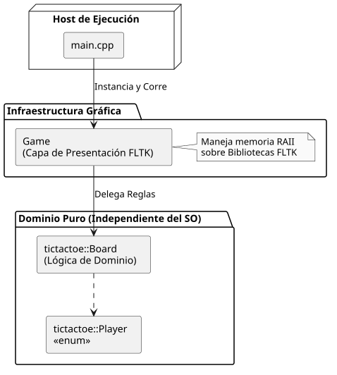
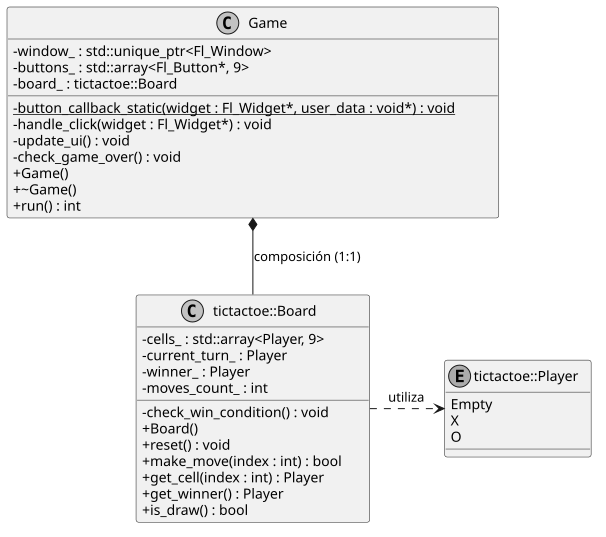
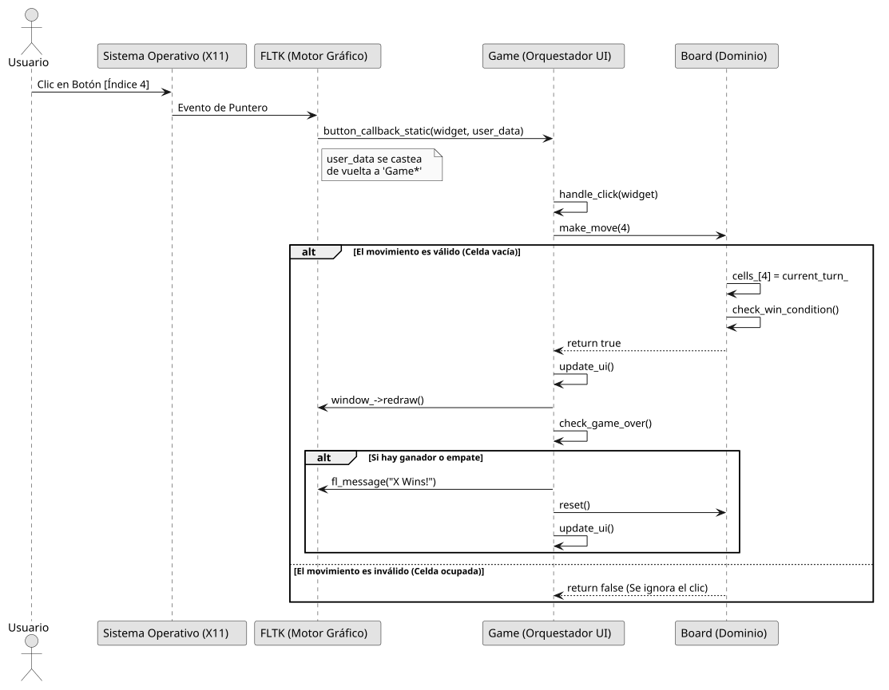

#  Ta Te Ti (Tic-Tac-Toe)

Un videojuego clásico implementado con la filosofía **GREENSOFT**: máxima eficiencia computacional, separación de responsabilidades y un uso responsable de los recursos de hardware. 

Desarrollado en **C++17**, la interfaz gráfica está impulsada por el toolkit **FLTK** (Fast Light Toolkit), operando bajo estándares estrictos de gestión de memoria automática (RAII) y punteros inteligentes, garantizando la ausencia de fugas de memoria (*memory leaks*).

---

## ⧉ Estructura Arquitectónica

El proyecto está diseñado para desacoplar completamente la lógica pura del dominio (el juego en sí) de la capa de presentación (la interfaz gráfica).

* **Lógica del Dominio (`tictactoe_logic.hpp`)**: Agnóstica de cualquier biblioteca gráfica. Contiene las reglas, la validación de condiciones de victoria y la gestión de turnos operando sobre un `std::array` de máxima eficiencia en memoria contigua.
* **Capa de Presentación (`game.hpp`)**: Orquestador que inicializa y destruye los componentes gráficos (FLTK) utilizando `std::unique_ptr` para la ventana principal. Mapea los clics del usuario hacia la lógica de dominio.
* **Host (`main.cpp`)**: Punto de entrada minimalista. Captura excepciones de infraestructura críticas e inicializa la aplicación.

---

## ⧉ Compilación y Ejecución (GNU/Linux)

El sistema ha sido probado y empaquetado para entornos GNU/Linux utilizando bibliotecas compartidas del sistema.

### Prerrequisitos
Asegúrese de contar con el compilador C++ de GNU (`g++`) y las dependencias de desarrollo de FLTK instaladas en el sistema (ej. `libfltk1.3-dev` en distribuciones basadas en Debian).

### Construcción
Ejecute el siguiente script desde la raíz del proyecto para enlazar dinámicamente el ejecutable:

```bash
#!/bin/bash
g++ \
-std=c++17 \
-Wall \
-ldl \
-I./include \
-I./include/vendors/fltk/include \
-I./lib/FL \
-L./include/vendors/fltk/lib/ \
./src/*.cpp \
-o ./bin/tictactoe \
-lfltk \
-lpthread
```

### Ejecución
```bash
./bin/tictactoe
```

---

## ⧉ Documentación Técnica (UML)

Los siguientes diagramas detallan la topología interna del software.

### 1. Diagrama Didáctico de Arquitectura
Representa la jerarquía del flujo de dependencia. La interfaz gráfica (UI) consulta y modifica el estado del dominio, pero el dominio ignora por completo la existencia de FLTK.



### 2. Diagrama de Clases
Muestra las clases, su visibilidad y las firmas de métodos más importantes. Se destaca la encapsulación (atributos privados) y el uso de punteros inteligentes para recursos gráficos.



### 3. Diagrama de Secuencia (Flujo de un turno)
Describe paso a paso qué ocurre cuando el usuario hace clic en un botón de la grilla gráfica durante la partida.

